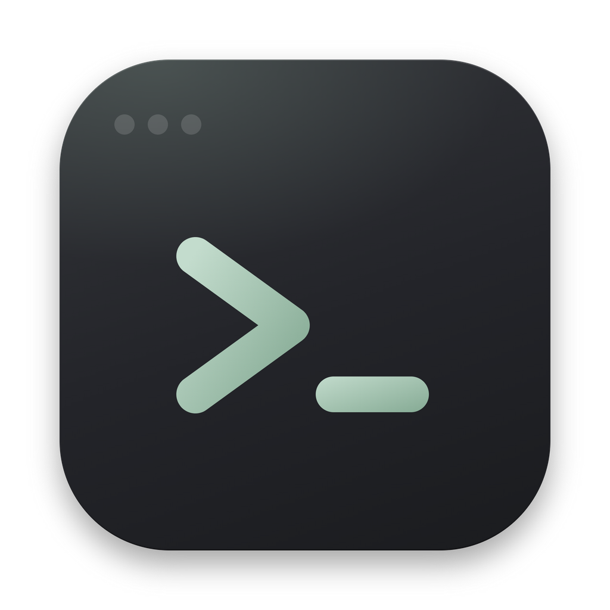
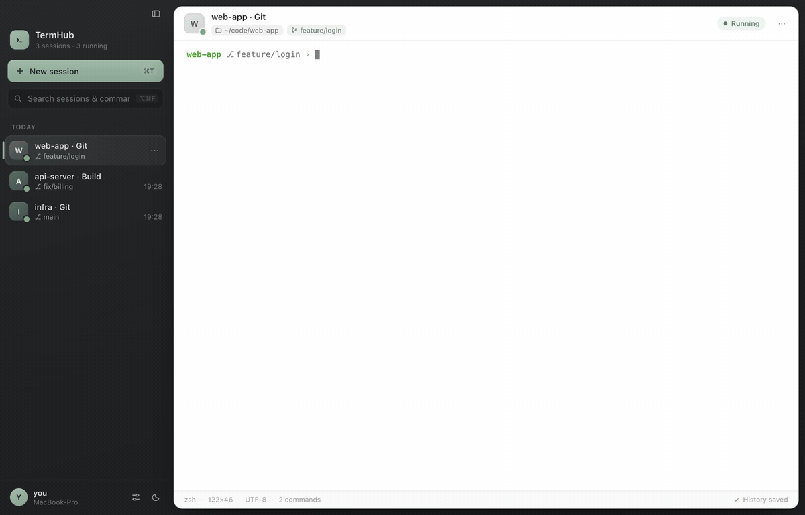
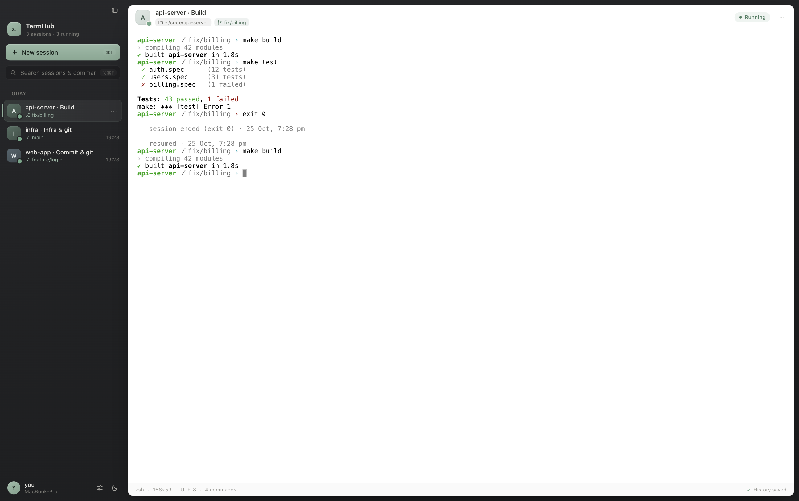
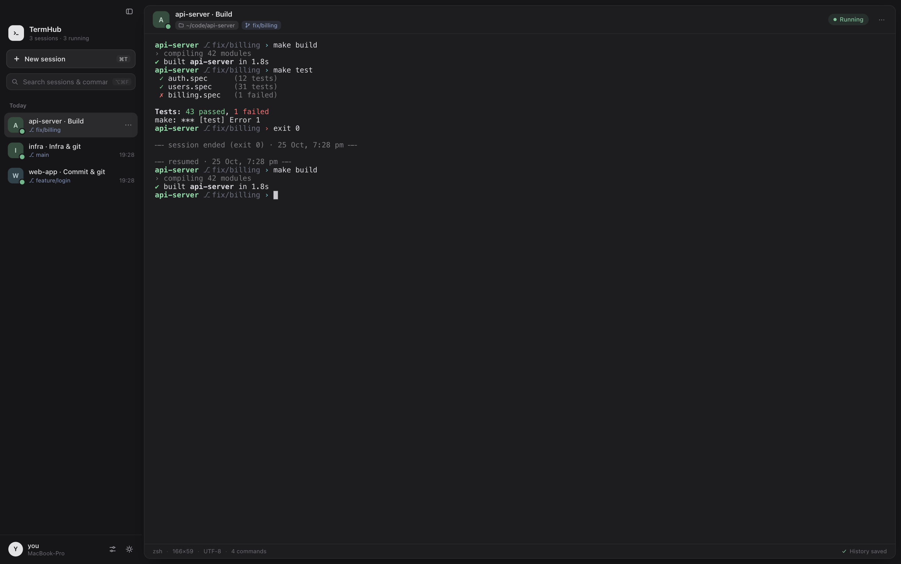

<div align="center">



# TermHub

**A Mac terminal that remembers every session.**

Closed a tab an hour ago and need that output back? Open it from the sidebar —
with its saved output — and pick up in the same folder.

[Features](#features) · [Install](#install) · [Shortcuts](#keyboard-shortcuts) · [How it compares](#how-it-compares) · [Design docs](#design-docs)



</div>

---

## Why

Terminal.app and iTerm2 are excellent at *running* shells, but once you close a tab its output is gone.
TermHub treats terminal sessions the way ChatGPT treats conversations: every session lands in a
sidebar, gets a short title describing what you did in it, and stays there — searchable and
resumable — until you delete it.

## Features

- **Session history sidebar** — sessions are grouped by *Pinned / Today / Yesterday / Previous 7 days / …*. Ended sessions keep their output (the most recent ~3–4 MB; the last 10,000 lines are scrollable when reopened). Open one and press <kbd>⌘R</kbd> to start a fresh shell in the same folder, appended to the same history.
- **Survives quits and restarts** — output is written to disk every 400 ms. Sessions that were running when you quit are reopened automatically on the next launch (after a crash they show as ended — press <kbd>⌘R</kbd> to resume).
- **Titles from the work you do** — headlines like `api-server · Tests & push` or `web-app · Commit & git`, derived locally from the commands you ran. Rename any session to pin your own title.
- **Search sessions** — <kbd>⌥⌘F</kbd> filters sessions by title, folder and the last 30 commands run in each. (Output isn't indexed; use <kbd>⌘F</kbd> inside a session.)
- **Git-aware** — each session shows its project and current branch, and follows `cd` and `git checkout` as you work.
- **Unread dots** — a background session that prints output gets a bold title and a dot (plus a Dock badge), Slack-style.
- **Feels like Terminal.app** — SF Mono with native macOS text rendering, Terminal's *Basic* color palette by default, and the shortcuts you already know.
- **A cleaner prompt** — `web-app ⎇ feature/login ›`, with the arrow turning red after a failed command. On by default for zsh; turn it off in Settings. Applied only inside TermHub; your `~/.zshrc`, `PATH` and `~/.zsh_history` are untouched, and custom prompts (oh-my-zsh, Starship, your own `PROMPT`) are left alone.
- **Themes** — *Graphite* (charcoal & sage, default), *Paper* (soft neutral), *Dark*, or *Match system*. In the light themes the terminal can use pure Mac Terminal colors or a softer theme palette; Dark always uses its own dark palette.
- **Focus mode** — <kbd>⇧⌘F</kbd> goes full screen and hides the sidebar.

<p align="center">
  
  
</p>

## Install

TermHub runs on **macOS** (Apple Silicon and Intel).

### Download

1. Grab the latest build from **[Releases](https://github.com/byte-coding/termhub/releases/latest)**:
   `TermHub-<version>-arm64.dmg` for Apple Silicon (M1 and later) or `TermHub-<version>-x64.dmg` for Intel Macs
   (not sure? Apple menu → *About This Mac* → *Chip*).
2. Open the DMG and drag **TermHub** into **Applications**.
3. The app is ad-hoc signed but not notarized by Apple, so the first launch is blocked. Open
   **System Settings → Privacy & Security**, scroll to the message about TermHub and click **Open Anyway**
   (on macOS 14 and earlier, right-click the app → **Open** also works).
   Prefer the terminal? `xattr -dr com.apple.quarantine /Applications/TermHub.app`

### Build from source

**Requirements:** Node.js 18 or newer, and Xcode Command Line Tools (`xcode-select --install`) for the native `node-pty` module.

```bash
git clone https://github.com/byte-coding/termhub.git
cd termhub
npm install          # also rebuilds node-pty for Electron
npm start            # run from source
```

To build a standalone app:

```bash
npm run dist                                   # → dist/mac-arm64/TermHub.app (or dist/mac/ on Intel)
cp -R dist/mac-arm64/TermHub.app /Applications/
```

Apps you build yourself aren't quarantined, so they open directly. To produce the same DMG/ZIP files as a
release (both architectures, ad-hoc signed), run `npm run release`; the Intel build compiles `node-pty`
with node-gyp, which needs a Python that still ships `distutils` (3.11 or older, e.g.
`npm_config_python=/usr/bin/python3 npm run release`).

<details>
<summary><b>Troubleshooting install</b></summary>

- **`Electron failed to install correctly`** — on some newer Node versions Electron's installer can exit without extracting its binary. Extract it from the download cache manually:
  ```bash
  ZIP=$(ls ~/Library/Caches/electron/*/electron-v*-darwin-*.zip | head -1)
  ditto -x -k "$ZIP" node_modules/electron/dist
  printf 'Electron.app/Contents/MacOS/Electron' > node_modules/electron/path.txt
  ```
- **`node-pty` build errors** — make sure Xcode Command Line Tools are installed, then run `npm run rebuild`.
</details>

## Keyboard shortcuts

| Action | Shortcut |
|---|---|
| New session · new session in same folder | <kbd>⌘T</kbd> · <kbd>⇧⌘T</kbd> |
| End shell (session stays in history) · resume shell | <kbd>⌘W</kbd> · <kbd>⌘R</kbd> |
| Previous / next session | <kbd>⇧⌘←</kbd> <kbd>⇧⌘→</kbd> · <kbd>⇧⌘[</kbd> <kbd>⇧⌘]</kbd> · <kbd>⌃⇧Tab</kbd> <kbd>⌃Tab</kbd> |
| Jump to session 1–8 · last session | <kbd>⌘1</kbd>…<kbd>⌘8</kbd> · <kbd>⌘9</kbd> |
| Find in output · next · previous | <kbd>⌘F</kbd> · <kbd>⌘G</kbd> · <kbd>⇧⌘G</kbd> |
| Search sessions & commands | <kbd>⌥⌘F</kbd> |
| Clear scrollback | <kbd>⌘K</kbd> |
| Rename · pin / unpin session | <kbd>⇧⌘R</kbd> · <kbd>⇧⌘P</kbd> |
| Toggle sidebar · focus mode (full screen) | <kbd>⌘\\</kbd> · <kbd>⇧⌘F</kbd> (or <kbd>⌃⌘F</kbd>) |
| Font size bigger · smaller · default | <kbd>⌘=</kbd> · <kbd>⌘-</kbd> · <kbd>⌘0</kbd> |
| Settings | <kbd>⌘,</kbd> |

Inside the terminal: <kbd>⌘←</kbd>/<kbd>⌘→</kbd> jump to line start/end, <kbd>⌘⌫</kbd> deletes the line, and <kbd>⌘</kbd>-click opens links. With *Use Option as Meta key* on (the default), <kbd>⌥←</kbd>/<kbd>⌥→</kbd> move by word and <kbd>⌥⌫</kbd> deletes a word.

## How it compares

TermHub is not a replacement for everything Terminal.app and iTerm2 do — it focuses on one gap: **what happens to a session after you close it.**

| | TermHub | Terminal.app | iTerm2 |
|---|:---:|:---:|:---:|
| Reopen windows that were open at quit, with their text | ✅ | ✅ | ✅ |
| Browsable, searchable list of sessions you *closed* earlier, with their output | ✅ | — | Partial ¹ |
| Session titles that summarize the work done | ✅ | — ² | — ² |
| Search across all sessions by title, folder and recent commands | ✅ | — | Partial ³ |
| Project + git branch shown per session | ✅ | — | Via status bar ⁴ |
| Split panes, tmux integration, profiles, triggers | — | Partial | ✅ |
| Secure Keyboard Entry | — | ✅ | ✅ |

<sub>¹ iTerm2 can undo a close for a few seconds, and can archive a session's scrollback when it closes (*Settings › Profiles › Session › Archive sessions on closure*), reopened by hand from *Shell › Archives*; there is no browsable history and the shell isn't resumed in the same folder. ² Both show the running process or a title the shell sets. ³ iTerm2's Shell Integration records command history per host. ⁴ iTerm2's configurable status bar can show the git branch.</sub>

If you rely on split panes, tmux control mode, or iTerm2's scripting API, keep using iTerm2 — TermHub doesn't have those (yet).

## Your data & privacy

- Everything stays on your Mac. TermHub makes no network requests of its own.
- Sessions live in `~/Library/Application Support/TermHub/`: `sessions.json` (titles, folders, branches, last 30 commands per session) and `sessions/<id>.log` (raw output, capped at ~4 MB per session).
- **Logs are plain text.** Anything printed to the screen — including secrets you `cat` — is stored there until you delete the session (right-click → *Delete…*).
- Commands are recorded only when the shell echoes them back, so passwords typed at hidden prompts are normally not recorded. It's a heuristic: hidden text that happens to match recent screen output can still be captured.
- Sessions in which you never ran a command are discarded automatically, unless you renamed or pinned them.

## Design docs

- [High-level design](docs/HLD.md) — architecture, process model, data flow, session lifecycle, key decisions.
- [Low-level design](docs/LLD.md) — module internals, file formats, IPC contract, algorithms, constants.

## Project layout

```
src/
  main.js        Electron main process: PTYs, persistence wiring, titles, menus, window
  store.js       On-disk session index, settings and buffered output logs
  preload.js     The only bridge between the page and the main process (contextBridge)
  renderer.js    UI: sidebar, xterm.js views, history replay, themes, shortcuts
  index.html     Markup        styles.css   Themes and layout
  shell/zsh/     Optional prompt integration (copied to a private ZDOTDIR at launch)
build/           App icon (icon.html is the source; `npm run icon` re-renders icon.png and icon.icns)
scripts/         make-icon.js, adhoc-sign.js (release signing hook)
.github/         Release workflow (builds and attaches DMG/ZIP files)
docs/            HLD, LLD and images
```

## Roadmap

- Command blocks with ✓/✗ and duration (shell-integration marks)
- Split panes
- Optional encryption of saved output
- Optional AI-written session summaries (opt-in; off by default)
- bash and fish prompt integration

## Contributing

Issues and pull requests are welcome. Run `npm start` to try changes; the app can be pointed at a throwaway data folder so it never touches your real sessions:

```bash
TERMHUB_USER_DATA=/tmp/termhub-dev npm start
```

## Releasing

Publishing a GitHub release (for example with tag `v0.2.0`) runs [`.github/workflows/release.yml`](.github/workflows/release.yml),
which builds the Apple Silicon and Intel DMG/ZIP files on a GitHub-hosted Mac, verifies their signatures and
attaches them to the release. It can also be re-run for an existing tag from the *Actions* tab.

## License

[MIT](LICENSE)
