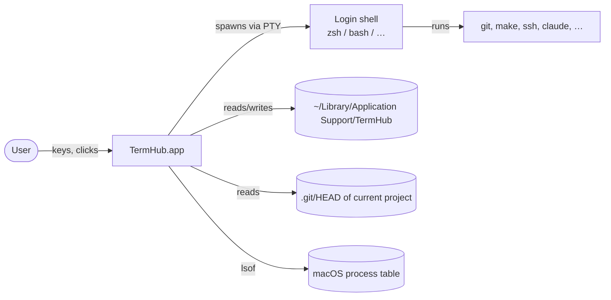
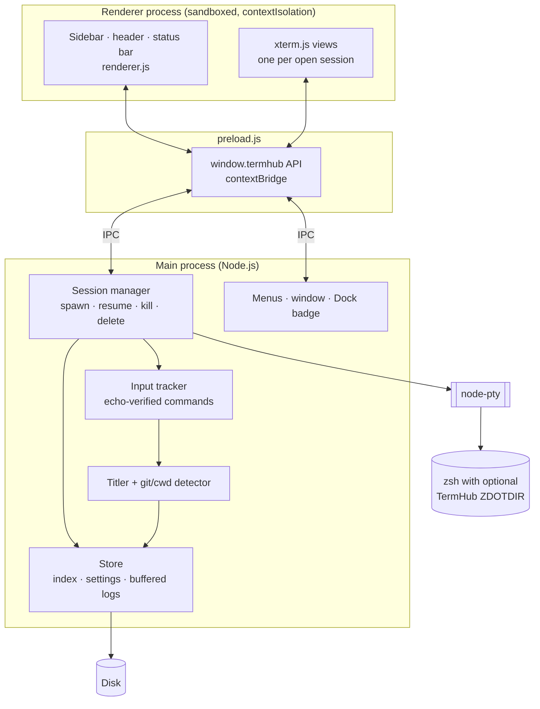
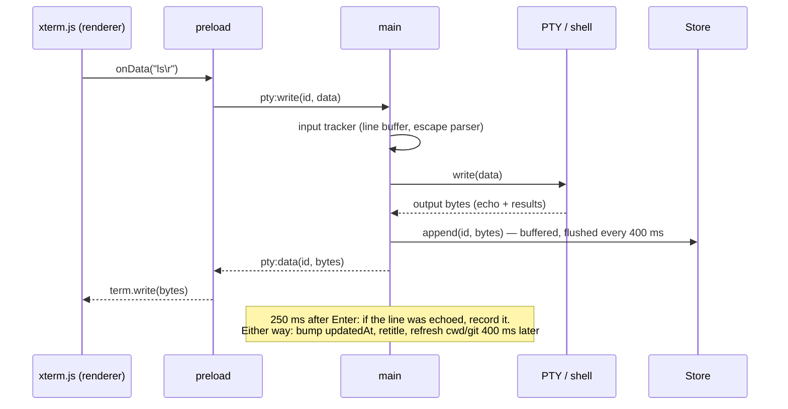
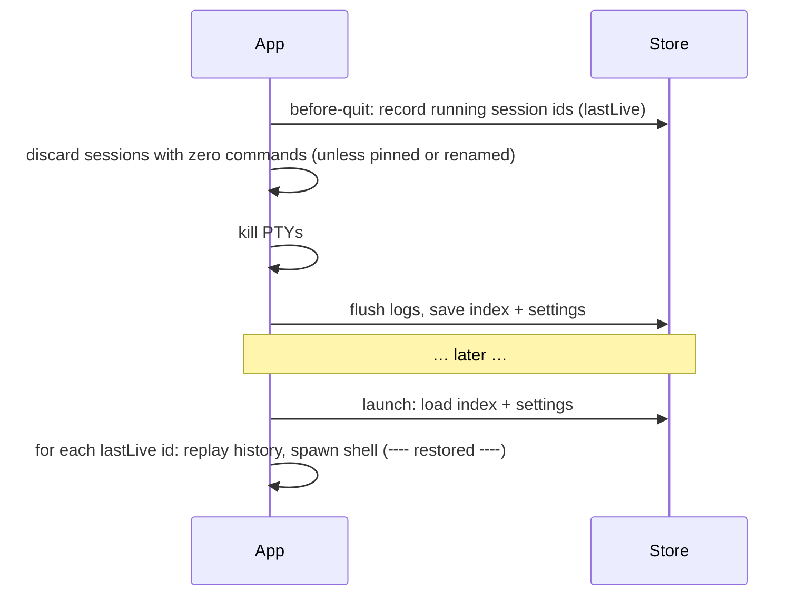
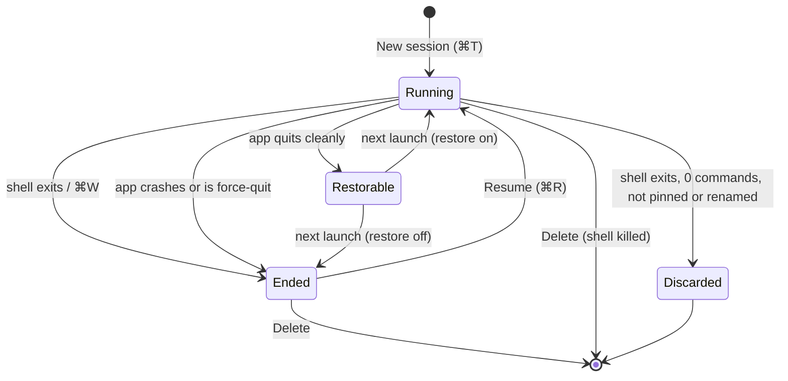

# TermHub — High-Level Design

## 1. Purpose

TermHub is a macOS terminal emulator whose organizing idea is **session history**. Every shell
session is recorded, titled, and kept in a sidebar so it can be found, read, and resumed long after
it was closed — the way chat apps keep conversations.

### Goals

| # | Goal |
|---|------|
| G1 | Every session's output survives closing the session, quitting the app, and restarting the Mac. |
| G2 | Ended sessions can be reopened and **resumed** (a new shell in the same folder, appended to the same history). |
| G3 | Sessions are identifiable at a glance: project, git branch, and a short title derived from what was done. |
| G4 | Typing in TermHub feels like Terminal.app: same font rendering, colors, and keyboard conventions. |
| G5 | Never alter the user's shell configuration or command history. |
| G6 | All data stays local. |

### Non-goals (current version)

- Split panes, tmux control mode, scripting API, profiles, triggers.
- Windows / Linux support.
- Reviving the *processes* of a closed session (a resumed session gets a new shell; only output is restored).
- Encrypting saved output (see §8).

## 2. System context

TermHub has no server component and makes no network requests of its own.

## 3. Architecture

TermHub is an Electron application with three code layers and one optional shell layer.

| Layer | Responsibility | Why here |
|---|---|---|
| **Main process** (`main.js`, `store.js`) | Owns every PTY, all persistence, title generation, git/cwd detection, native menus, window and Dock. | Needs Node APIs (PTYs, filesystem, child processes). Single source of truth for session state. |
| **Preload** (`preload.js`) | Exposes a fixed, minimal `window.termhub` API over IPC. | Lets the page stay sandboxed with no Node access. |
| **Renderer** (`renderer.js`, `index.html`, `styles.css`) | All UI: sidebar, xterm.js terminals, history replay, themes, shortcuts, unread state. | Pure presentation; can be reloaded without losing sessions. |
| **Shell integration** (`src/shell/zsh/*`) | Optional styled prompt via a private `ZDOTDIR` that sources the user's own config first. | Changes the prompt without touching `~/.zshrc`. |

## 4. Key flows

### 4.1 Keystroke → shell → screen

### 4.2 Reopening an ended session

1. User clicks an ended session in the sidebar.
2. Renderer creates an xterm view and asks main for `session:history`.
3. Main flushes pending writes and returns the raw log.
4. Renderer replays it, strips zsh's partial-line markers, and resets terminal modes (mouse reporting,
   bracketed paste, alternate screen if a full-screen app was left open) so the view is inert.
5. On **Resume**, main appends a `╌╌ resumed ╌╌` marker and spawns a new shell in the session's last
   known folder; new output continues the same log.

### 4.3 Quit and relaunch

## 5. Session lifecycle

After a crash `before-quit` never runs, so nothing is marked for restore: sessions that were running appear as Ended (their output up to the last 400 ms flush is kept) and can be resumed by hand.

A session is a durable record (id, title, folder, branch, recent commands, timestamps) plus an
append-only output log. "Running" only means a PTY is currently attached.

## 6. Data model (summary)

| Data | Where | Notes |
|---|---|---|
| Session index | `sessions.json` | Array of session records; rewritten atomically (temp file + rename) on every change. |
| Output logs | `sessions/<id>.log` | Raw PTY bytes. Buffered and appended every 400 ms; trimmed to the newest ~3 MB once over 4 MB. |
| Settings | `settings.json` | Theme, fonts, window bounds, sidebar, `lastLive`, feature toggles. |
| Shell integration | `shell/zsh/.z*` | Regenerated from the app bundle at every launch. |

Full schemas are in the [LLD](LLD.md#3-persistence).

## 7. Titles and metadata

- **Commands** are reconstructed from keystrokes in the main process. A line only counts if its typed
  text appears in the shell's output around the Enter (echo check, 250 ms), and not while a full-screen
  (alternate-screen) app is open, so text typed at hidden prompts and inside vim/less is normally not
  recorded. This is a heuristic: hidden text that matches recent screen output can still be captured,
  commands recalled from history (↑, ^R) are not recorded, and Tab-completed commands are stored as the
  typed prefix.
- **Titles** are `project · Top task & second task`, e.g. `api-server · Tests & push`. Commands map to
  weighted task labels (commit/push/PR highest, read-only git commands low, unrecognised commands
  lowest and shown by name); recent commands weigh more.
  Users can rename a session, which locks its title.
- **Project and branch** come from walking up from the shell's working directory (read with `lsof`)
  to the nearest `.git` below the home folder (the home folder itself is never treated as a project),
  then reading `HEAD` directly (worktrees supported). No `git` process is spawned.

## 8. Security and privacy model

| Concern | Design |
|---|---|
| Page compromise (e.g. via a malicious link) | Renderer runs with `sandbox: true`, `contextIsolation: true`, `nodeIntegration: false`, a strict CSP (`script-src 'self'`), navigation blocked, and new-window requests denied — only `http(s)` URLs are handed to `shell.openExternal` (opened by the default browser). |
| Surface between page and Node | Only the fixed `window.termhub` methods; the page has no direct file or process access. **But the bridge is equivalent to shell access**: `createSession` + `write` start a shell and type into it, so a compromised renderer means code execution as the user. The sandbox, CSP and navigation rules exist to keep the page from being compromised, not to contain it afterwards. |
| Shell configuration | Never edited. The optional prompt uses a private `ZDOTDIR` that sources the user's files and restores `ZDOTDIR` and `HISTFILE` afterwards. |
| Environment leakage | Shells inherit the app's environment minus Electron internals and inherited `CLAUDECODE` / `CLAUDE_CODE_*` markers, so tools started inside TermHub don't think they are nested. |
| Data at rest | **Plain text.** Output logs can contain anything printed to the screen. Mitigations today: local-only storage, per-session delete, automatic discard of empty sessions. Encryption is on the roadmap. |
| Single writer | A single-instance lock ensures only one TermHub process writes a given data folder. |

## 9. Key design decisions

| Decision | Alternatives considered | Rationale |
|---|---|---|
| **Electron + xterm.js + node-pty** | Tauri + xterm.js; native Swift + SwiftTerm | Fastest path to a polished UI with a proven terminal engine (the same stack as VS Code's terminal). Cost: higher memory than native. |
| **Store raw PTY bytes and replay them** | Serialize xterm's buffer on close | Raw append is crash-safe (at most 400 ms lost) and works even if the app dies; replay is cheap. Cost: replay depends on the current width, and the log must be sanitized when reopened. |
| **Echo-verified command capture** | Shell hooks (OSC 133 / precmd) only | Works with any shell and needs no shell changes; verifying the echo keeps hidden input out. Cost: heuristic — history recall isn't recorded, Tab completion stores the typed prefix, and lines whose typed text never appears in output are dropped. |
| **Local heuristic titles** | LLM summaries | Instant, private, deterministic. An opt-in AI summary is on the roadmap. |
| **Private ZDOTDIR for the prompt** | Edit `~/.zshrc`; ship a prompt framework | Zero footprint on the user's config; skipped automatically if a custom prompt exists. |
| **Shifted-punctuation / arrow shortcuts (⇧⌘[ ] ← →, ⇧⌘F, ⌃Tab, ⌃⌘F) handled in the renderer by `KeyboardEvent.code`**; everything else is a native menu accelerator | Native menu accelerators for all | On macOS, Electron menu accelerators for shifted punctuation (e.g. `⇧⌘[`) don't fire reliably and can't be "display only"; handling them in the page is layout-independent and avoids double-firing. |
| **Native (DOM) text rendering by default** | xterm WebGL renderer | Matches Terminal.app's font smoothing; WebGL is kept behind a `gpuRendering` setting. |

## 10. Limitations

- macOS only; the styled prompt is zsh only (other shells run with their own prompt).
- No split panes or tabs-within-a-window.
- Replayed history is re-wrapped to the current width.
- ⌘W ends the shell immediately (there is no "processes still running" confirmation yet).
- The packaged app is not code-signed or notarized.

## 11. Future work

Command blocks (✓/✗ + duration via shell-integration marks), split panes, encrypted logs, opt-in AI
titles, bash/fish integration, signed releases.
